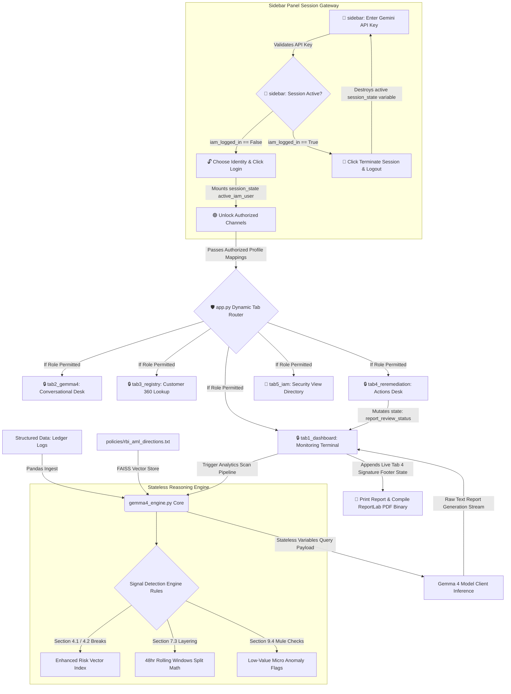
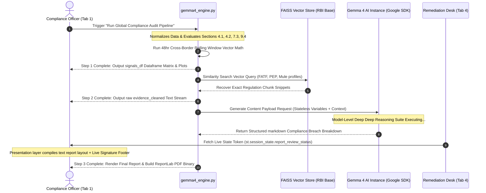

# 🛡️ Risk-Gemma4-Agent Panel

An enterprise-grade **Anti-Money Laundering (AML) and Counter-Terrorist Financing (CFT)** risk intelligence dashboard panel. This system couples high-performance automated data processing with deep semantic compliance reasoning via the **Gemma 4 LLM** architecture (`gemma-4-26b-a4b-it`) and **LangChain Vector RAG stores**, adhering strictly to the Reserve Bank of India (RBI) Master KYC Directions.

## 🏗️ System Architecture & Session Gateway Lifecycle

The platform is engineered using a modular, decoupled architecture separating stateless analytical data compute layers (`gemma4_engine.py`) from dynamic, role-restricted presentation layers (`app.py` and `tabs/`). The global session management authentication loop is handled persistently through the left sidebar console.


## 🔀 Compliance Pipeline Execution Sequence

The terminal operates on a strict three-step line-of-custody pipeline tracking financial anomalies from signal detection to audit-ready legal documentation:



---

## 🔐 Identity & Access Management (IAM) Matrix

The system simulates a zero-trust financial backoffice terminal with rigid **Role-Based Access Control (RBAC)** filters managed from a centralized sidebar login terminal.

| Identity Profile Registry | Access Role Node | Clearance Hierarchy | Unlocked Workspace Channels | Write Capabilities |
| :--- | :--- | :--- | :--- | :--- |
| **Appala Srinivas Tanakala** | `SYSTEM_ADMIN` | Level 4 - Full Access | All 5 Application Tabs | Full provisioning, system parameters configuration, manual overrides, cache clearance. |
| **Anita Sharma** | `COMPLIANCE_ANALYST` | Level 2 - Intelligence Access | Tabs 1, 2, 3, 4, 5 | Full investigation capability, interaction with the AI engine, and containment actions desk. |
| **Priya Patel** | `SENIOR_AUDITOR` | Level 3 - Audit Review | Tabs 1, 3, 5 | Read data logs, extract ReportLab PDF packages. Tab 5 user-creation form is **completely hidden and write-locked**. |
| **Rajesh Kumar** | `JUNIOR_CLERK` | Level 1 - Basic Read | Tab 1 Only | Read-only access to main dashboard KPIs. All other panels hidden. Global logout managed via sidebar. |

---

## ⚙️ Automated Compliance Core Engine Rules

1. **Section 4.1 High-Value Cross-Border Rule:** Flags cross-border moves exceeding ₹5,000,000 to FATF tax havens (`KY`, `CH`). If marked `IS_PEP`, prompts for senior verification.
2. **Section 4.2 Unverified PEP Lockout:** If an outbound transaction is initiated by a `Pending` KYC account flagged as a Politically Exposed Person (`IS_PEP == True`), the engine overrides standard risk formulas and throws an **Immediate 100% Risk Score System Lock**.
3. **Section 7.3 Layering Velocity Math:** Groups corporate ledgers dynamically to catch entities executing separate international transaction legs to multiple offshore country codes within a rolling 48-hour window (+25 Risk Index Multiplier).
4. **Section 9.4 Cyber-Fraud Mule Sweep:** Scans small-scale routing logs down to **₹1,000** on unverified or suspended account nodes to identify micro-smurfing networks, triggering an automated placeholder in the `REMEDIATION_LOG`.

---

## 🛠️ Repository File Subdirectory Tree

```text
risk-gemma4-agent/
├── app.py                  # Orchestrator core hub, memory registers, global sidebar session controller
├── gemma4_engine.py        # Stateless backend analytical compute, math vectors, similarity searches
├── requirements.txt        # System application dependency pinning configuration
├── data/
│   ├── account_master.csv       # Centralized consumer profiles and KYC verification metadata
│   └── transaction_ledger.csv   # Financial transaction ledger payload logs
├── policies/
│   └── rbi_aml_directions.txt   # Official regulatory policy text used for similarity context injection
└── tabs/
    ├── __init__.py         # Module package indicator file (Ensures clean cross-imports)
    ├── tab1_dashboard.py   # Run compliance audits, view Plotly graphs, export ReportLab PDFs
    ├── tab2_gemma4.py      # Conversational Gemma4 compliance assistant workspace
    ├── tab3_registry.py    # Customer 360 lookup, tracks active locks, blocks ledger access on active freezes
    ├── tab4_reremediation.py# Dispatch manual containment protocols, run automated rules loops
    └── tab5_iam.py         # IAM security simulation desk (Features write-lock overrides for Auditors)
```

---

## 🚀 Quick Start Deployment Guide

### 1. Provision Local Virtual Environment Dependencies
```bash
pip install -r requirements.txt
```

### 2. Set Up Environment Workspace Keys
```bash
export GOOGLE_API_KEY="your-gemini-api-key-from-google-ai-studio"
```

### 3. Launch the Streamlit Terminal Instance
```bash
streamlit run app.py
```
